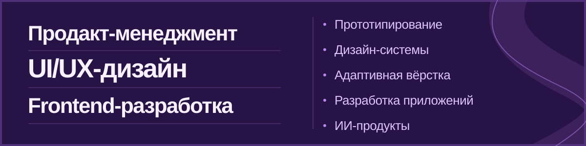

## Проекты

### Simple CRM
Спроектировала мобильную CRM: сценарии, дизайн-систему и 25 экранов. Сделала адаптивный многостраничный лендинг для презентации продукта.

[Смотреть лендинг](https://kiolymi.github.io/SimpleCRM_Landing/)

### [AI Stylist](https://github.com/MaximB0nd/ai-stylist) · лид проекта
Веду проект и отвечаю за продакт-менеджмент, дизайн и frontend.

### [НейроЭксперт / AI Checker](https://github.com/sqtwix/ai-checker) · командный проект
Платформа для анализа результатов тестирования. 

## Командные проекты с закрытым кодом

**Graph Algo.** Сделала модуль образовательной траектории: он строит порядок изучения тем по зависимостям и показывает критический путь. Репозиторий закрыт.

**AI Society Simulator.** Командный прототип мультиагентной симуляции. Репозиторий закрыт.

## Другие командные работы

[AI Review Analyzer](https://github.com/sqtwix/ai-review-analyzer) — система для анализа отзывов из таблиц. Участвовала в команде проекта.
